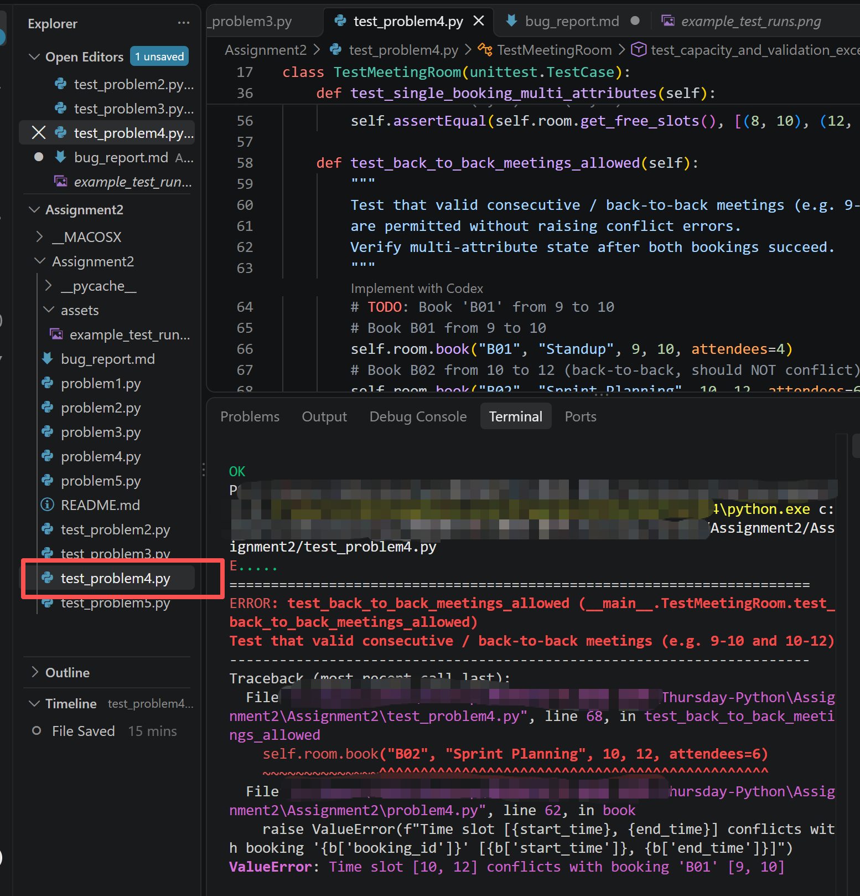
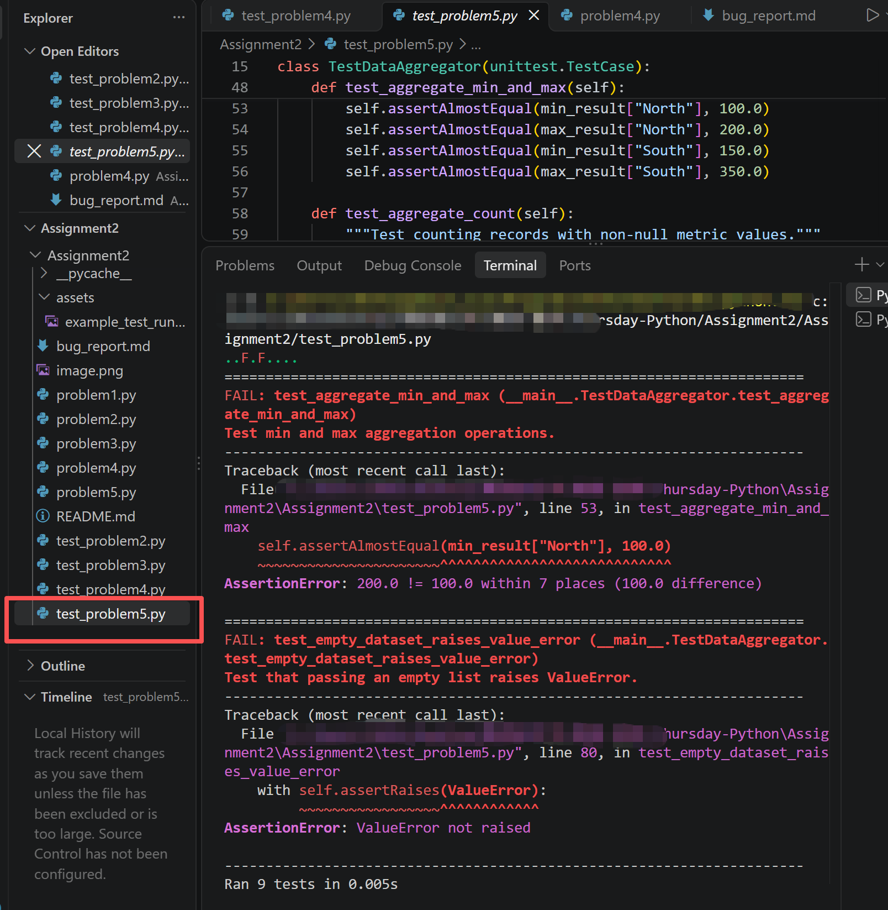

# Bug Report

This report documents the bugs discovered in the buggy programs, including the failing test cases, root cause analysis, and the applied code fixes.

---

## Bug Report 1: (Example)

### 1. Program Under Test
- **File:** `problemX.py`
- **Class / Function:** `YourClassName.method_name()`

### 2. Failing Test Case
Provide the unit test code from `test_problemX.py` that exposed the bug and failed during execution:

```python
# Paste your failing test method here
def test_example_failure(self):
    pass
```

Provide the captured test runs from VSCode.


**Test Output / Error Message:**
```text
# Paste error traceback / assertion failure message here
```

### 3. Root Cause Analysis
Explain why the bug occurred and what incorrect behavior it caused:
- **Expected Behavior:** (What should happen according to the specifications)
- **Actual Behavior:** (What happened in the starter code)
- **Root Cause:** (Explanation of the bug in the code logic)

### 4. Code Fix & Diff
Show the changes made to `problemX.py` to fix the bug:

```diff
- # Original buggy code line
+ # Corrected code line
```

---

## Bug Report 2: Back-to-back meetings incorrectly flagged as conflicts

### 1. Program Under Test
- **File:** `problem4.py`
- **Class / Function:** `MeetingRoom.book()`

### 2. Failing Test Case
Provide the unit test code from `test_problem4.py` that exposed the bug and failed during execution:

```python
def test_back_to_back_meetings_allowed(self):
    # Book B01 from 9 to 10
    self.room.book("B01", "Standup", 9, 10, attendees=4)
    # Book B02 from 10 to 12 (back-to-back, should NOT conflict)
    self.room.book("B02", "Sprint Planning", 10, 12, attendees=6)
```

Provide the captured test runs from VSCode.


**Test Output / Error Message:**
```text
# Paste error traceback / assertion failure message here

ValueError: Time slot [10, 12] conflicts with booking 'B01' [9, 10]

```

### 3. Root Cause Analysis
Explain why the bug occurred and what incorrect behavior it caused:
- **Expected Behavior:** Back-to-back meetings (e.g. 9-10 and 10-12) should be allowed because they do not actually overlap.
- **Actual Behavior:** Booking a meeting that starts exactly when a previous one ends was rejected as a time conflict.
- **Root Cause:** The overlap check used strict inequalities (`<` and `>`) instead of non-strict (`<=` and `>=`). With strict comparison, `10 > 10` evaluates to `False`, so the boundary-touching case was incorrectly treated as an overlap.

### 4. Code Fix & Diff
Show the changes made to `problem4.py` to fix the bug:

```diff
- if not (end_time < b["start_time"] or start_time > b["end_time"]):
+ if not (end_time <= b["start_time"] or start_time >= b["end_time"]):

```


## Bug Report 3: min/max aggregation functions are swapped

### 1. Program Under Test
- **File:** `problem5.py`
- **Class / Function:** `clean_and_aggregate()`

### 2. Failing Test Case
Provide the unit test code from `test_problem5.py` that exposed the bug and failed during execution:

```python
def test_aggregate_min_and_max(self):
    """Test min and max aggregation operations."""
    min_result = clean_and_aggregate(self.sample_sales, group_by="region", metric="sales", aggregation="min")
    max_result = clean_and_aggregate(self.sample_sales, group_by="region", metric="sales", aggregation="max")

    self.assertAlmostEqual(min_result["North"], 100.0)
    self.assertAlmostEqual(max_result["North"], 200.0)
```

Provide the captured test runs from VSCode.


**Test Output / Error Message:**
```text
# Paste error traceback / assertion failure message here

AssertionError: 200.0 != 100.0 within 7 places (100.0 difference)

```

### 3. Root Cause Analysis
Explain why the bug occurred and what incorrect behavior it caused:
- **Expected Behavior:** When `aggregation="min"`, return the smallest value in each group. When `aggregation="max"`, return the largest.
- **Actual Behavior:** The `min` branch called `max()` and the `max` branch called `min()` — they were swapped. Asking for "min" returned the largest number.
- **Root Cause:** Copy-paste error in the if/elif chain — the two function calls were written backwards.

### 4. Code Fix & Diff
Show the changes made to `problem5.py` to fix the bug:

```diff
elif agg_op == "min":
-           val = max(values)
+           val = min(values)
        elif agg_op == "max":
-           val = min(values)
+           val = max(values)
```

---

## Bug Report 4: Empty records list does not raise ValueError

### 1. Program Under Test
- **File:** `problem5.py`
- **Class / Function:** `clean_and_aggregate()`

### 2. Failing Test Case
Provide the unit test code from `test_problem5.py` that exposed the bug and failed during execution:

```python
def test_empty_dataset_raises_value_error(self):
    """Test that passing an empty list raises ValueError."""
    with self.assertRaises(ValueError):
        clean_and_aggregate([], group_by="region", metric="sales")
```

Provide the captured test runs from VSCode.


**Test Output / Error Message:**
```text
# Paste error traceback / assertion failure message here

AssertionError: ValueError not raised

```

### 3. Root Cause Analysis
Explain why the bug occurred and what incorrect behavior it caused:
- **Expected Behavior:** The docstring specifies that passing an empty `records` list should raise `ValueError`.
- **Actual Behavior:** The function silently returned an empty dict `{}` instead of raising the expected exception.
- **Root Cause:** The input validation check for empty records was missing entirely from the code.

### 4. Code Fix & Diff
Show the changes made to `problem5.py` to fix the bug:

```diff
     if agg_op not in valid_aggregations:
         raise ValueError(f"Invalid aggregation '{aggregation}'. Must be one of {valid_aggregations}")
+    if not records:
+        raise ValueError("records cannot be empty")

```